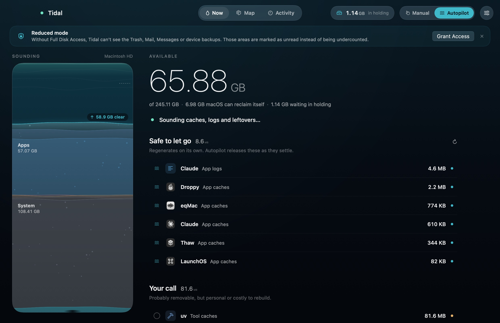
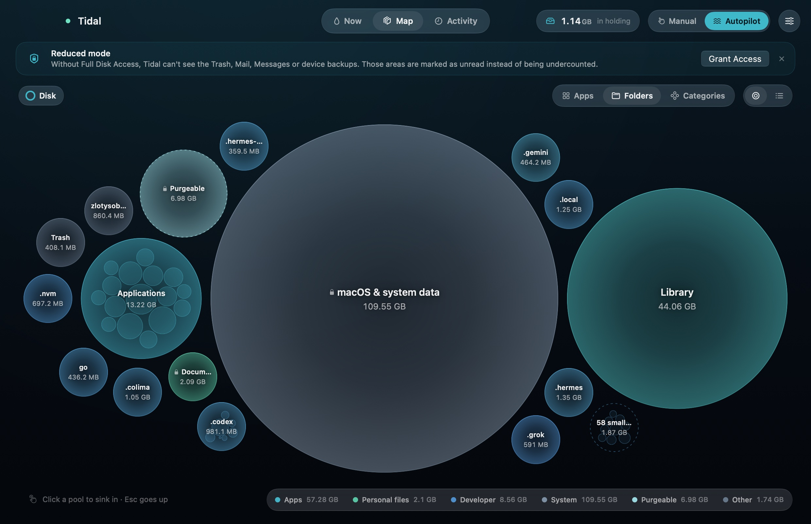
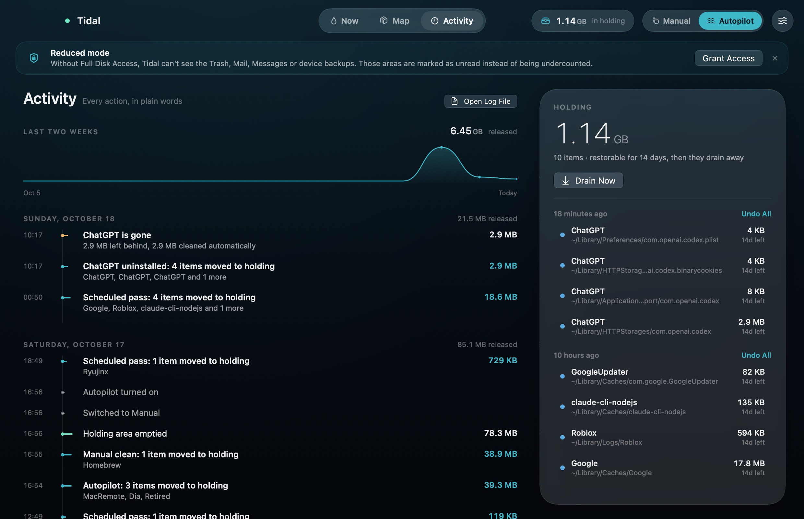

<h1 align="center">Tidal 🌊</h1>

<p align="center">
  <b>A free, open-source disk cleaner for macOS that never deletes anything right away.</b><br>
  Finds caches, logs and leftovers, sorts them into <i>Safe</i> and <i>Review</i>, and can clean up on its own.
</p>

<p align="center">
  <a href="../../releases/latest"></a>
</p>

<p align="center">
  
  
  
  
</p>

<p align="center">
  
</p>

## Why Tidal

- **Nothing is deleted straight away.** Cleaned items go to a *holding area* and stay restorable for 14 days, then released for good. Made a mistake? One click on **Undo**.
- **Safe vs Review.** *Safe* is stuff that regenerates on its own (app caches, logs, package manager downloads). *Review* is probably removable, but personal or costly to rebuild (like old Xcode archives), so it's your call.
- **Autopilot.** Turn it on and Tidal cleans Safe items as they appear, plus password-free system data like temp folders and Homebrew leftovers. A background agent keeps working while the app is closed.
- **See where your disk went.** The **Map** shows everything using your space as tidepools: pools sized by how much they hold, with the contents of each resting inside. Click one to sink in, or switch to a plain list.
- **Everything is logged in plain words.** The **Activity** screen shows every action Tidal took.
- **A hard "never touch" list.** Some locations are blocked outright, including Tidal's own data.
- **Native and tiny.** Pure Swift and SwiftUI, no dependencies, no accounts, no telemetry.

## Screenshots

| Now | Map | Activity |
| :---: | :---: | :---: |
|  |  |  |

## Download

1. Grab **Tidal.zip** from the [latest release](../../releases/latest).
2. Unzip it and move `Tidal.app` to Applications.
3. The app is ad-hoc signed, not notarized, so on first launch **right-click → Open**.

> **Made by Claude Opus 5.5.** This entire app was written by Anthropic's Claude Opus 5.5
> (via Claude Code). It moves files around your disk, so read the code before you run it.
> That's exactly why it's open source.

## Build from source

Requires macOS 27 and Xcode with the Swift toolchain.

```bash
./build.sh            # builds ./build/Tidal.app
./build.sh install    # builds and copies to /Applications
```

## Contributing

Cleanup rules live in [`Resources/catalog.json`](Resources/catalog.json). Supporting another
app's caches is a **one-entry pull request**, no Swift needed. See [CONTRIBUTING.md](CONTRIBUTING.md).

Found a bug or want an app supported? [Open an issue](../../issues/new/choose).

## License

MIT

---

<p align="center">Made by <b>0vyx</b><br></p>
